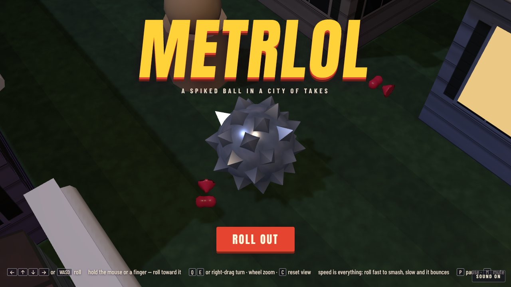
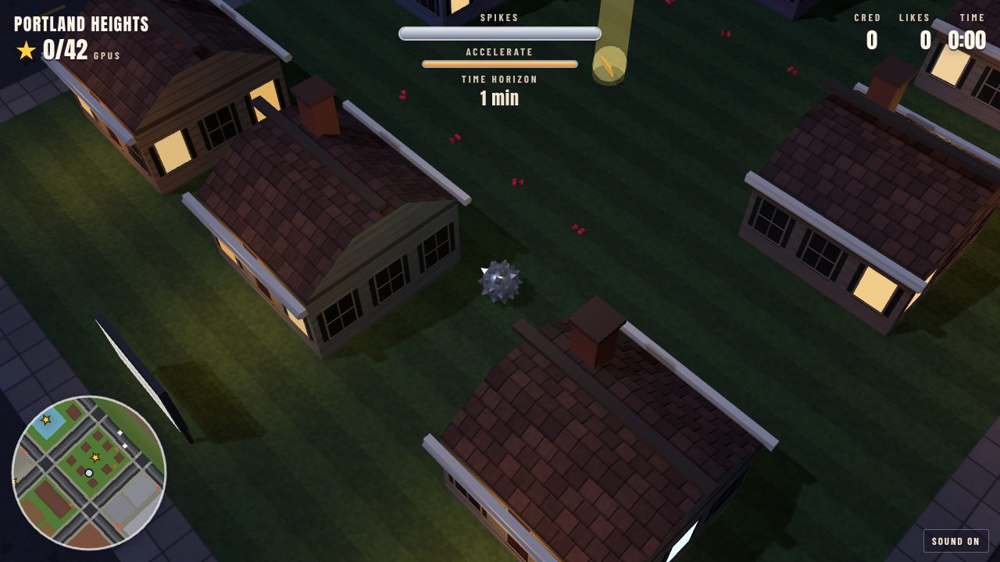
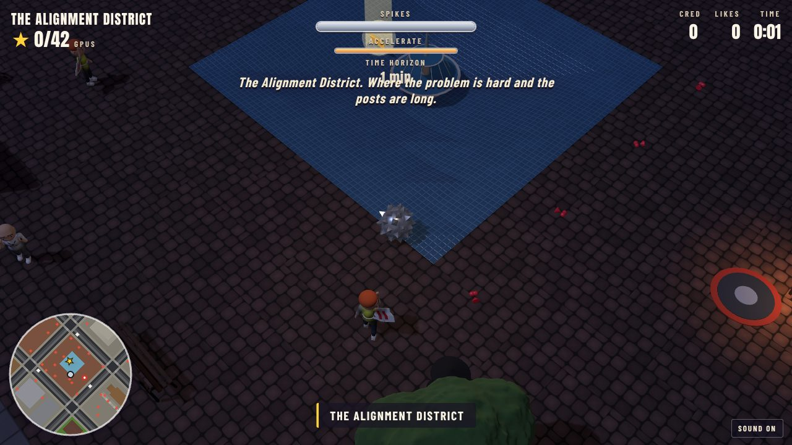
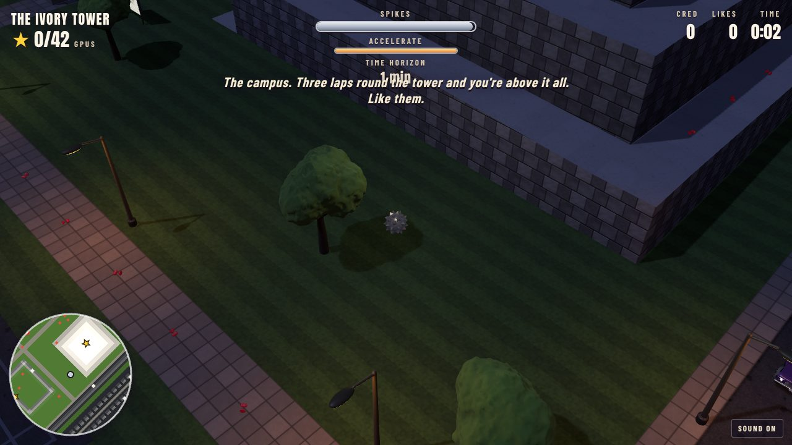
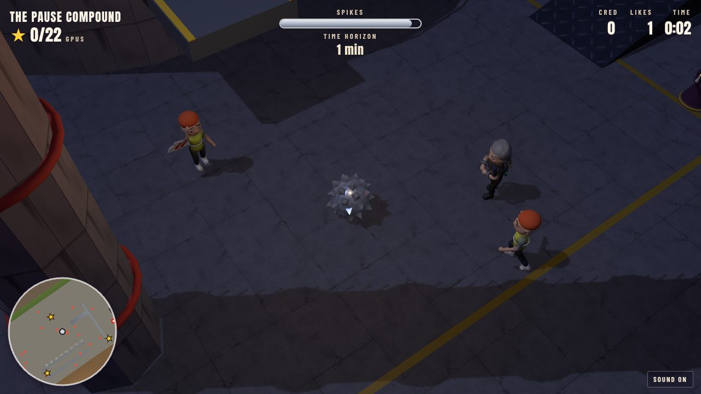
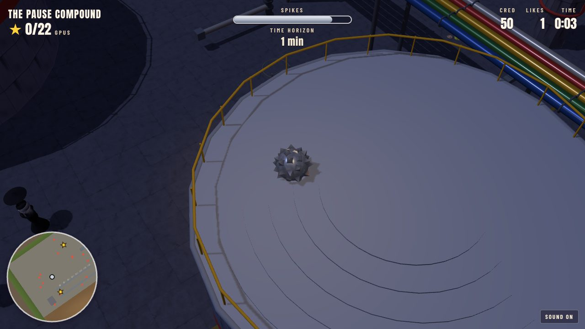
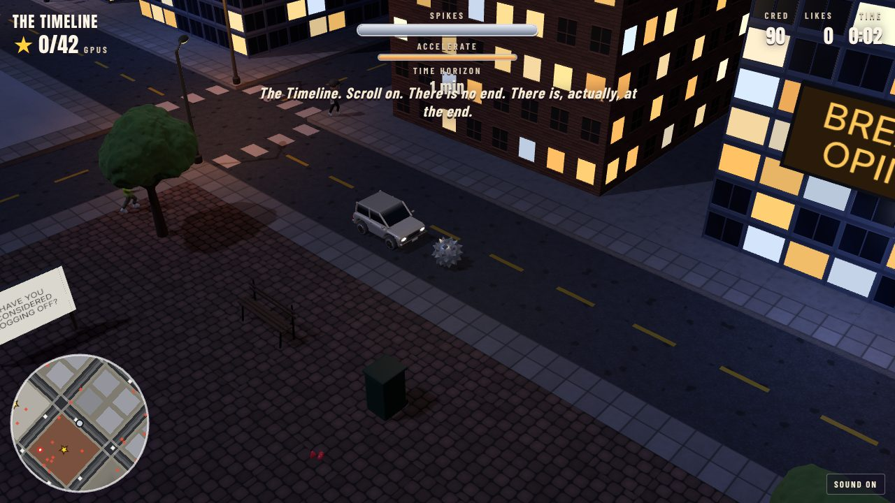
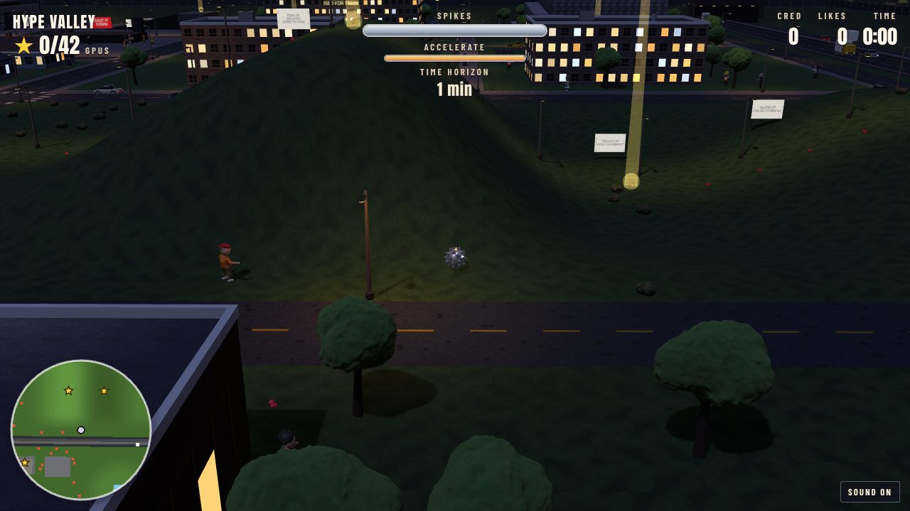
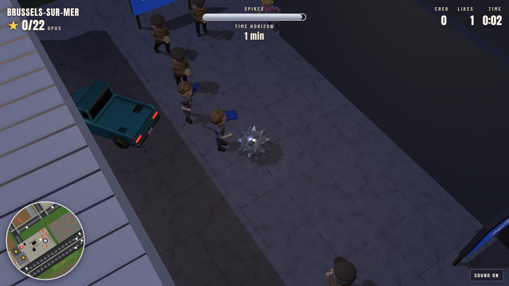
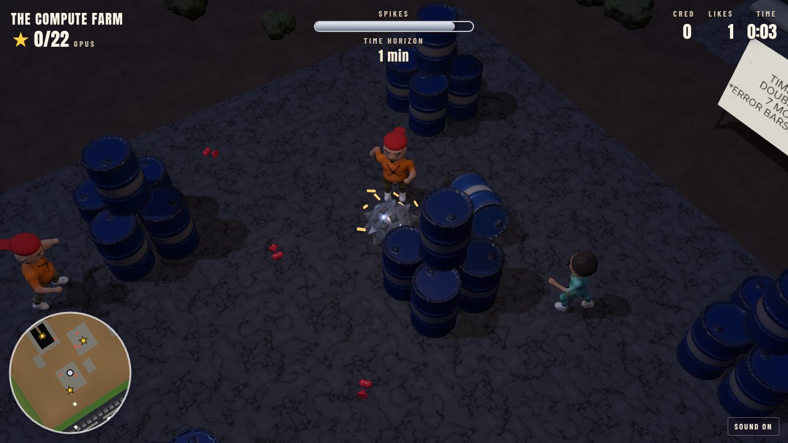

# Metrlol

A spiked steel ball, the head of a morning star with no morning star
attached, is loose in an open city of takes. There are no tracks and no
levels: Metrlol is one map, all of it there from the start, and the ball can
roll anywhere it can get to. In the way is the discourse: the Pause crowd and
the doomers, the effective altruists and the rationalists, the commune and
the theorists, the Eurocrats on strike, the accelerationists on a podcast,
and the reply guys, who are everywhere. Roll into them fast enough and they
are smashed; too slowly and they bounce off, and it costs you spikes. Each
time, the ball says something unkind about it.

Somewhere in all of it are **42 golden GPUs**. Every side of the argument
wants them. The ball is keeping them.

The sequel to [Metroll](https://github.com/h1ddenpr0cess20/metroll), and
made of the games before it:

- **the engine** is [Petroll](https://github.com/h1ddenpr0cess20/petroll)'s: its renderer, ball physics, tiled map builder, traffic, hazards, minimap and HUD. The map is Metrlol's own: a city of nine parts, 256 tiles each way (four times the area of Petroleum Springs), with a few of Petroll's set pieces in it (the car park up to the roof, the skate park, the consensus maze, the footbridge, the plank to the island), and like Petroll's it is tested to be rollable from end to end;
- **the ball, the smash rules, the cast, the quips and the band** are Metroll's: the morning star's head, whose spikes snap off as it is knocked about; speed is everything (`smash.js`); the sculpted people (`src/cast/`, mostly in new clothes, plus a Pause protester and a Eurocrat); the sarcasm; and the music, played live in Web Audio;
- **the sculptor** is from the [Rock 'n' Roller](https://github.com/h1ddenpr0cess20/rocknroller-iii) games.

It is satire of ideas, not of anyone in particular, and it is an
equal-opportunity ball: the doomers get it, and so do the accelerationists,
the commune, the Eurocrats, and you.



## Run

```sh
git clone https://github.com/h1ddenpr0cess20/metrlol
cd metrlol
npm install
npm run dev               # → http://localhost:5173
```

A static page: no server, no keys. `npm run build` puts it in `dist/`, which
runs from any folder. WebGPU where the browser has it, WebGL 2 where it
doesn't (`?renderer=webgl` pins it). Node 22.12 or later.

## Play

| | |
|---|---|
| <kbd>←</kbd><kbd>↑</kbd><kbd>↓</kbd><kbd>→</kbd> or <kbd>WASD</kbd> | Roll. Up always rolls up the screen, however the view is turned. |
| Hold the mouse or a finger | Roll toward the pointer. The further it is from the ball, the harder the push. |
| <kbd>Space</kbd> or <kbd>Shift</kbd> | **Accelerate**: hold for a harder push and a higher top speed, until the meter runs dry (it refills when you let go). The ACCELERATE button on a touch screen. |
| <kbd>Q</kbd> <kbd>E</kbd>, or drag with the right mouse button | Turn the view. Dragging up and down tilts it. |
| Mouse wheel, or <kbd>+</kbd> <kbd>−</kbd> | Zoom. |
| Two fingers | Pinch to zoom, twist to turn, drag up or down to tilt. |
| <kbd>C</kbd> | Put the view back. |
| Gamepad | Left stick or d-pad rolls; right stick turns and tilts; shoulder buttons zoom; <kbd>A</kbd>, <kbd>X</kbd> or the right trigger accelerates; <kbd>Start</kbd> pauses. |
| <kbd>P</kbd> / <kbd>Esc</kbd> | An intermission (pause). |
| <kbd>M</kbd> | Sound on or off. |

### Speed is everything

How hard the ball hits someone is how fast the two were coming together, in
tiles a second, *their* walking included. Everybody has a **toughness**, the
speed it takes to smash them in one go, and a **power**, how much it hurts to
bounce off them.

| Speed | | What happens |
|---|---|---|
| 1.7 times what it takes (13 at the least) | **OBLITERATED!** | Gone, with double the cred. |
| At least their toughness | **SMASHED!** | Gone, thrown clear, and it costs the ball nothing. |
| Over half their toughness | **BONK** | You both bounce, and it costs some spikes, less the closer you were to a smash. |
| Under that | **WEAK** | It hurts, all of their power, and they don't move. |

Someone who isn't smashed is still worn down, so a doorman you can't hit hard
enough can be hit twice. The Prophet of Doom takes a good deal more.

- **Acceleration** is how you hit what you couldn't: hold it and the ball reaches speeds that smash anyone but the toughest (the doorman, datacentre security, the old bird) and the bosses. It runs dry in about three seconds, and refills in five.
- **Cred** is the score. Smashes build a **combo** (×5 at most) that multiplies each one.
- **Time horizon**, up in the corner, doubles every six smashes. The line goes up.
- **Props** go too: bins, benches, mailboxes, signs, hydrants, street lamps, trees, charging posts, parked cars, and the bronze paperclip in the plaza. Each has a speed it takes (a cone 2.5, a bin 4, a lamp post 9, the paperclip 14), and is as solid as a wall below it. They are worth a little cred each, and come back with a new run.
- **Likes** are the little hearts lying about in lines. They are validation, and worth nothing.

### Staying in one piece

The ball starts with 100 **spikes**, and you can watch them snap off. It is a lump of forged steel and takes a beating: every knock costs half what it would. Hard
landings, cars, cable reels rolling after it, the hot takes coming up out of
the floor and the people it fails to smash take them away. At nothing the ball
is **blunted**, and it is back at the last **whetstone** it rolled over,
sharpened. A rubber stamp coming down on it blunts it outright. The data lake
and the sea swallow it, and it's put back on the last firm ground.

What you've found, the last whetstone and the time so far are kept in the
browser (`metrlol.v1`), and the game plays the same with storage blocked.

## Metrlol

Nine parts of town, three across and three down, the superhighway down the east side, and the far side of it.

| | |
|---|---|
|  | **Portland Heights**, north-west: the suburbs, and home. Co-op houses, a drained pool that is now the community garden, a tiny house village, the consensus maze (still voting on the exit), a skate park with a quarter pipe you need a run-up for, the commune's long house and allotments, the food co-op with a loading ramp up to its roof, the park. The commune, the anarchists, the theorists, the doomscrollers. |
|  | **The Alignment District**, north: the Longterm Institute and the alley behind it, a group house with a car park up to the roof, **the slippery slope** (oil all the way up: take a run at it), the doom clock and the prediction market round it, the plaza where the Pause protest has been for a year (a bronze paperclip on a plinth in the middle of it), the SHUT IT DOWN rally stage, the Effective Altruism Center, a building site whose crane has been paused since March. Doomers, effective altruists, rationalists, forecasters, safety researchers. |
|  | **The Ivory Tower**, north-east: the campus. The library (closed for training), the lecture hall sunk in the quad, **the trolley problem**, going round and round, and the tower itself: a ramp three times round it to the top, where you are above it all. Rationalists, researchers, theorists, purists, longtermists. |
|  | **The Pause Compound**, west: behind a fence, the tank of doom with a lift up its side, a ramp and a catwalk, the barracks, the bunker sunk in the yard, and **hot takes alley**, where they come up out of the floor in a wave you have to ride the gap behind. And  **the Prophet of Doom**, who has predicted the end of the world every year since 2003 and has been, technically, early. |
|  | **The Timeline**, the middle: downtown. Towers with screens on them (TRENDING: YOU), **Ratio Square**, the echo chamber (a round room in a round room), the discourse pit, **the infinite scroll** (a walkway in the air, over the street, to the end of it, with a troll under it), and the engagement farm, where the likes are grown in rows. Reply guys, engagement farmers, Substack writers, thought leaders, gatekeepers. |
|  | **Hype Valley**, east: **the hype cycle**, in hills, lit all along: up the peak of inflated expectations, down into the trough of disillusionment, up the slope of enlightenment to the plateau of productivity, and off the plateau a footbridge over the superhighway to the far side. The garage where it all started, the podcast studio (hour 3), VC row, and the infinity pool on top of Sand Hill. Accelerationists, VCs, podcasters. |
|  | **Brussels-sur-Mer**, south-west: the Commission, **the stamping hall** (rubber stamps coming down on the lane: in to the end and back out), a charging station (+21% VAT), the Euro shop (closed, lunch) with a ramp to its roof, a regulatory sandbox with actual sand in it, the strike picket, a club with a queue that has been there since Thursday, the Grand-Place, and the seafront: the beach, the pier, and the sea, which you sink in. Eurocrats, strikers, scooter commuters, ravers, the doorman (the policy is no). |
|  | **The Compute Farm**, south-east: the server halls and the hot aisle between them, the cooling towers (a lift up the far one), the chilled water main to roll along the top of, **the hockey stick** (flat for a long way, then LINE GO UP), the data lake with an island in it, the cable yard where the reels come after you, the substation. Accelerationists, VCs, podcasters. |
| | **The Information Superhighway**: four lanes of trucks and cars in both directions, through tunnels at each end. Nobody brakes. Nobody reads. On **the far side**, the cookie banner on its hill. |

The music is Metroll's hardcore track (New York, 1989: a d-beat, no encores), start to finish.

## The cast

Seventy-three kinds of people, about 440 of them, sculpted in code
(`src/cast/`) and baked in background workers while the page loads. Who they
are, and what they shout, is in `src/foes.js`. They come from the games before
it, in new names:

- **from Metroll**: the doomer (the mourner), the forecaster (the coroner), the longtermist (the wizard), the effective altruist (the straight-edge kid: *donates ten percent, does not shut up about the ten percent*), the rationalists, the reply guys and most of the rest; and now the protest singer (the folkie), the dropout founder (the skater), the pallbearer, the dead internet (the zombie), the lab rat, Schrödinger's cat, the humanoid robot, the datacentre technician (the welder), the SRE on call (the sound guy), the cable wrangler (the roadie), datacentre security, the crypto bro (Florida Man), the AI ethicist (the medic), the shoggoth enjoyer (the goth) and the keeper of the weights (the knight);
- **from Rock 'n' Roller**: the YIMBY (the hipster), the NIMBY (the angry neighbour), the AI influencer, the main character (phone guy), the old bird (the mascot), the founder (the A&R suit);
- **from Rock 'n' Roller II**: the recruiter (the agent), the prepper (the cowboy), the newsletter kid (the newsie), the screenshotter (the paparazzo), the tourist, a non-human intelligence (the rubber alien), and **the Billionaire** (the mogul), a boss, up on Sand Hill by the infinity pool;
- **from Rock 'n' Roller III**: the tenured professor (the city gent), the thought experimenter (the mime), the postdoc (the archaeologist), the biohacker (the bull runner), the VC's corgi, the cyclist, the waiter (on strike), the cab driver, the lifeguard, the surfer, nonna, the hot take vendor, and **the Edge Case** (the yeti), a boss, out on the far side past the edge of the training data;
- **sculpted already but never cast till now**: the data protection officer (the beat cop), the prompt engineer (the scene kid), the simulation theorist (the stoner) and the festival bro (the beer guy);
- **new in Metrlol**: the Pause protester and the Eurocrat.

## How it's made

| | |
|---|---|
| `src/vendor/gfx/` | Alan's renderer, as in Petroll, unchanged. |
| `src/mace.js`, `src/morningstar.js`, `src/ball.js` | The ball: Metroll's, untouched. |
| `src/cast/` | The people (`person.js`, `humanoid.js`, the rig and the skin), their library and bake worker. |
| `src/foes.js`, `src/crowd.js`, `src/smash.js` | Who is in the way, how they walk and come at the ball, and what a meeting costs. |
| `src/quips.js` | What the ball says, and the time horizon. |
| `src/map.js`, `src/town.js` | The map: a grid of tiles, with road paint, props, solids, traffic, hazards, pickups, signs and the crowd on top of them; and Metrlol, part of town by part of town. |
| `src/structures.js`, `src/models/` | What stands on the map: signs, screens and billboards with words on them, tanks, the mast, the crane, parasols; sculpted street furniture, vehicles, charging posts, rubber stamps, cable reels, whetstones, likes and GPUs. |
| `src/run.js` | The world as it runs, with nothing drawn: the rules for spikes, smashes, combos, pickups. The game draws it; the tests drive it. |
| `src/music.js`, `src/audio.js` | Metroll's band, and every sound effect, synthesised. |

| Script | |
|---|---|
| `npm run dev` | Vite dev server (and `/preview.html`: `?foes=pauser,eurocrat`, `?foes=all`, `?hurt=0.5`) |
| `npm run build` | Bundles to `dist/` |
| `npm test` | `node:test`: physics, the map builder, the city, the traffic, the hazards, the crowd and the smash rules, and an autopilot that has to find all 42 golden GPUs in one go without being blunted |
| `npm run lint` | ESLint |

In the browser console, `metrlol.debug.teleport(x, z)` puts the ball anywhere
on the map.
